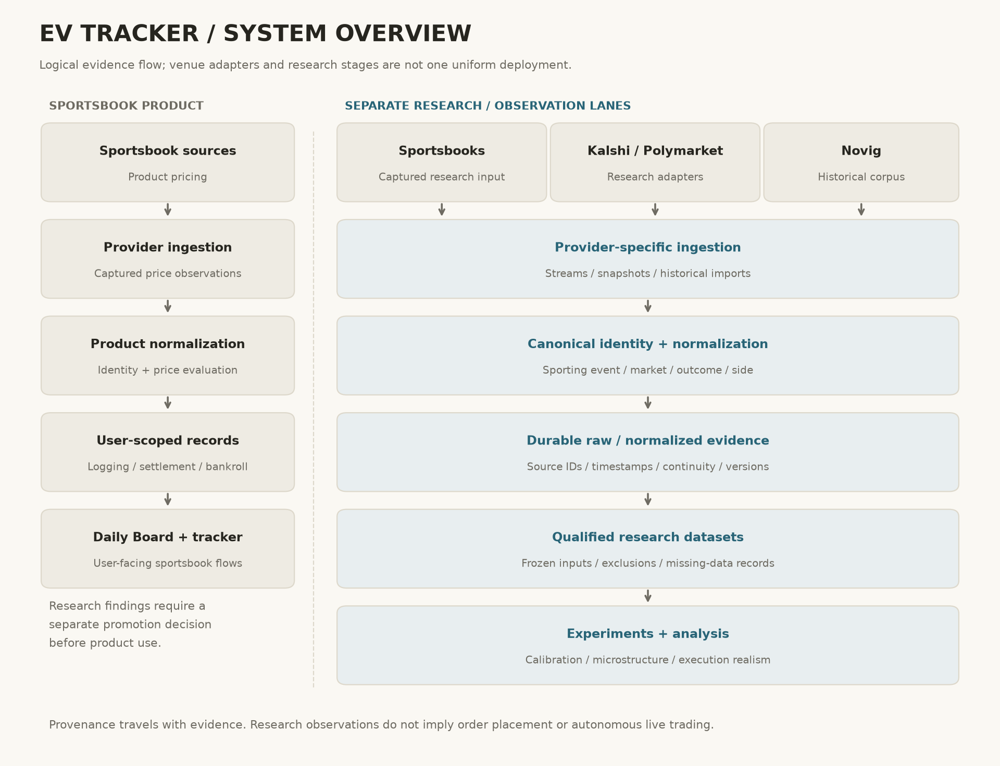

# EV Tracker

EV Tracker is a privately developed sports-market research system covering pricing, exchange data, event normalization, fair-value evaluation, execution analysis, sportsbook settlement recordkeeping, and durable research evidence.

The production repository remains private because it contains proprietary research methods and production integrations under active development. This portfolio publishes architecture, protocols, aggregate results, and engineering evidence sufficient to discuss and evaluate the work without disclosing those methods.

## Selected Research Scale

| Verified fact | What it measures |
|---|---|
| **7,722 captured sportsbook opportunities** | Unique captures, not placed bets. [S1](evidence/README.md#sportsbook-evidence-s1) |
| **5,248 valid closing observations across 873 event clusters** | Usable closing references; within-event observations remain dependent. [S1](evidence/README.md#sportsbook-evidence-s1) |
| **70,598 observed market executions across 85 games** | Novig observations, including pregame and later executions; not personal trades. [S2](evidence/README.md#novig-evidence-s2s6) |
| **12 frozen candidate hypotheses; zero survivors** | Rules frozen before historical evaluation; one additional diagnostic control. No prospective validation. [S3–S6](evidence/README.md#novig-evidence-s2s6) |

## System Architecture

[Diagram notes and UI captures](architecture/README.md). Exchange research remains separate from the sportsbook product.

## Selected Research

- [Sportsbook calibration](studies/sportsbook-calibration.md): chronological evaluation and event-cluster uncertainty; ranking information without proof of profit.
- [Novig microstructure](studies/novig-microstructure.md): frozen hypotheses, side controls, and a preserved negative result.
- [Execution realism](studies/execution-realism.md): apparent reversal largely disappears under same-side measurement.

## Market-Data Engineering

[Kalshi market data](engineering/kalshi-market-data.md): snapshot/delta reconstruction, continuity, timestamps, bounded reconnects, and implementation limits.

## Reliability / Provenance

[Evidence and state](engineering/reliability-and-provenance.md): frozen inputs, append-only capture, durable ownership, explicit failures, settlement semantics, and testing.

## About the Source Code

Production code, credentials, configuration, feature formulas, candidate-selection rules, and deployment details are withheld. [Backing notes](evidence/README.md) identify what reviewers can independently inspect.

## Claims and Limitations

- Observed executions are market data, not personal trading volume.
- Closing-line value (CLV) measures price quality, not realized ROI or ground-truth probability.
- Modeled fills are not actual fills. No profitable strategy or autonomous live trading is established here.
- Historical results do not establish future performance. Negative results and missing observations remain visible.
- Private methods and raw records limit independent reproduction.

[Release review](evidence/release-review.md) · [Claim-evidence inventory](evidence/README.md)
