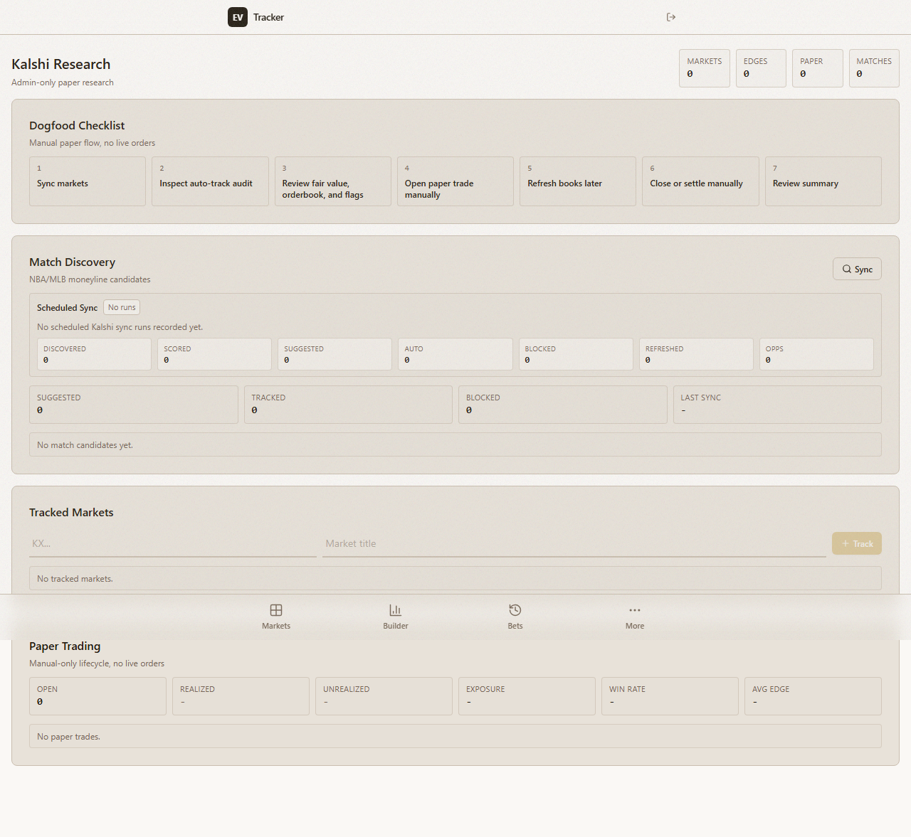
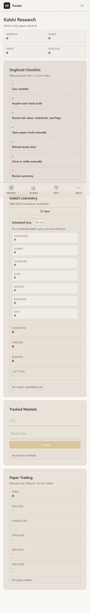

# Architecture and selected screenshots

The diagram summarizes concepts backed by the inspected system and research owners. Sportsbooks feed the product and captured research evidence. Kalshi and Polymarket adapters shown here belong to separate research/observation lanes; Novig supplies the historical execution corpus used by the selected study. The arrows express logical data flow, not one uniformly deployed pipeline or a live-trading path. Polymarket venue variants are not interchangeable; this view makes no claim of universal venue coverage.

Canonical sporting-event identity, market/outcome mapping, timestamps, and transformation provenance connect captured observations to downstream datasets. The product lane contains the board, logging, settlement, and bankroll recordkeeping. Research output is not promoted into that lane by the portfolio.

**Source:** inspected high-level architecture and research identity, recorder, lifecycle, and calibration owners; [engineering backing notes](../evidence/README.md#engineering-evidence-e1e6). No credentials, infrastructure addresses, or private feature definitions appear in the diagram.

## Selected UI captures

These are pre-existing captures of the actual application from the local visual-test artifact directory. Both were visually inspected at readable scale for visible private information, and their PNG metadata was checked. They show empty states: the displayed zero counts describe these captured screens, not research sample sizes or trading performance. Capture time and backend state were not independently established. The accompanying test definition identifies an authenticated research-page capture flow, but these images do not establish a passing test run or current production state.

### Desktop: manual research workflow

**Caption:** The research UI makes manual paper actions and tracked-market state visible. Its “no live orders” language distinguishes the displayed paper workflow from real execution. No account identity, credential, private endpoint, or populated strategy data is visible.

### Mobile: the same research workflow

**Caption:** The existing mobile capture shows the same manual checklist and empty-state panels in a narrow viewport. The navigation overlaps parts of the long page; this is a preserved screenshot, not a newly polished product mockup. It supplies interface evidence, not live research or fill evidence.

**Source:** [Screenshot backing notes](../evidence/README.md#screenshots). The images were copied unchanged after visual review; no redaction was needed because the selected frames contain no visible sensitive values.
