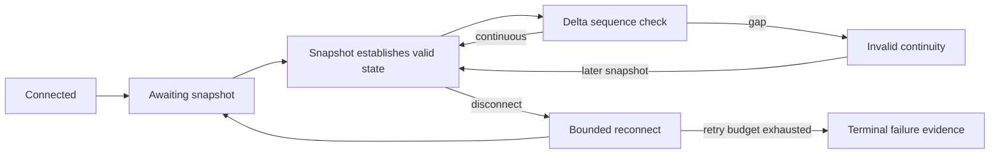

# Kalshi market data: reconstruction with explicit continuity limits

The engineering problem is to maintain interpretable exchange state through snapshots, deltas, trades, and connection lifecycle events. A latest-price poll cannot establish the sequence of book changes or explain what was lost during a disconnect.

This case study describes a retained read-only WebSocket research implementation and its offline evidence pipeline. It does not claim an observed live uptime, a production trading deployment, or current exchange API conformance. [Implementation evidence E1–E4](../evidence/README.md#engineering-evidence-e1e6) was inspected locally; production source is withheld.

## Identity and reconstruction

Provider market identifiers select the subscribed instruments. Each instrument has its own local binary-outcome bid ladders. Normalization then binds venue outcomes to the canonical sporting event and target team; it must resolve outcome orientation rather than infer it from list order.

A snapshot replaces the local ladders. Signed quantity deltas update a price level and remove levels when retained quantity is non-positive. Best bids come from those ladders; opposing-outcome bids support the binary-market ask representation. Trades remain separate observations with their own side and identifiers; a trade is not silently substituted for a book update.

## Continuity and reconnects

Sequence scope matters: numbers associated with a shared subscription must not be assumed to advance independently for every ticker. The retained client deliberately uses shared continuity over its bounded ticker set rather than one counter per instrument. A sequence discontinuity marks affected updates untrusted. Reconnects reuse the configured instruments, with a bounded attempt budget and explicit terminal failure.

**Implementation boundary:** the inspected parser does not retain or route subscription IDs and uses one shared continuity object. It marks that object valid when a recognized snapshot arrives; it does not demonstrate a fresh-snapshot barrier for every ticker. Trades inherit the current validity flag without independently checking their sequence. Missing sequence values do not establish gap detection. Accordingly, this portfolio does not claim complete isolation across subscriptions, comprehensive trade-sequence validation, or fully fresh multi-instrument books after reconnect.

Invalid deltas may still update the retained local ladder and be recorded with invalid continuity. Fail-closed analysis means excluding untrusted observations from qualified comparisons; it does not mean every untrusted message is dropped. A sequence gap itself marks invalidity rather than automatically forcing an immediate reconnect.

## Timing and provenance

The parser records wall-clock and monotonic receive times before decoding a message. Venue timestamps, when supplied, remain separate. Receive time supports within-process observation timing; it does not establish synchronized exchange clocks, network latency, or causal lead/lag.

Normalized evidence carries event/outcome identity, provider identity, connection and sequence information, message type, continuity validity, and transformation/release provenance. It distinguishes a streaming update from an interval-sampled REST snapshot. Missing fields remain missing.

The transport's lifecycle events are connection events, such as reconnecting and terminal failure. Sporting-event finality and settlement are separate state semantics discussed in [reliability and provenance](reliability-and-provenance.md). The retained client subscribes to book and trade data; this writeup does not imply a dedicated exchange market-lifecycle subscription.

## Durable evidence and testing

The recorder uses create-only run artifacts and an append-only event file. An interrupted run can remain inspectable without overwriting previous evidence. The simple recorder's best-effort reader can skip malformed lines; it is not a sealed, lossless raw-message archive. Stronger sealed lifecycle evidence uses a separate integrity-checked store, described on the supporting page.

Retained regression tests exercise snapshot gating, sequence gaps, snapshot resynchronization, bounded reconnects, receive timestamps, fixed subscriptions, outcome normalization, and preservation of interrupted runs. Structural tests constrain outbound client messages to subscriptions. These tests support specific implementation behavior, not a guarantee about every malformed message or live operating condition.

**Source:** [Engineering evidence inventory](../evidence/README.md#engineering-evidence-e1e6). **Important caveat:** evidence consists of private implementation inspection and retained test definitions. No live capture, credential use, or new production qualification was performed for this portfolio.
