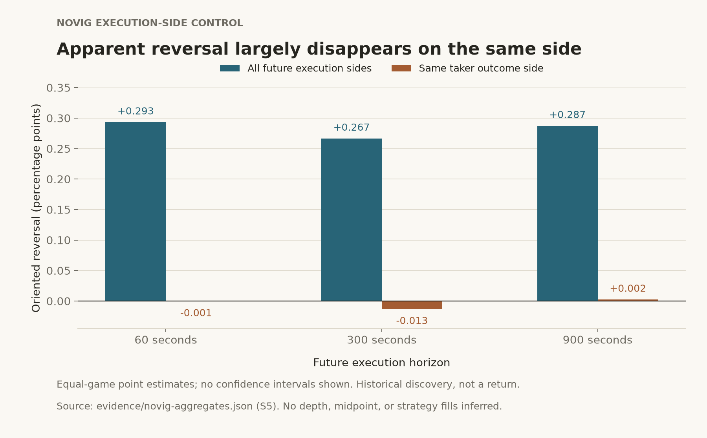

# Novig microstructure: a frozen tournament with no survivors

## Question

Do state-conditioned patterns in observed MLB moneyline executions indicate persistent price movement, or do they reflect execution mechanics and instability across games and dates?

## Data

The qualified historical corpus contains **70,598 observed taker executions across 85 canonical games**. Its earliest and latest execution timestamps are **2026-08-14 04:00:00.615 UTC** and **2026-08-19 03:59:53.177 UTC**. These bounds describe the retained corpus, not continuous complete market coverage.

The headline total includes **46,992 pregame executions** and **23,606 at or after scheduled start**. The tournament uses pregame eligibility rules; the full corpus count is not the eligible sample for every hypothesis. These are observed market executions, not the developer's trades.

**Source:** [Novig aggregate evidence](../evidence/novig-aggregates.json), corpus qualification S2. **Meaning:** acquisition counts and canonical game identities. **Caveat:** individual tests have smaller eligible populations and incomplete future same-side observations.

## Method

The internal specification froze **12 candidate hypotheses plus one diagnostic control** before outcome evaluation. The freeze record therefore contains **13 entries**. This is an internal frozen-before-results protocol, not a claim of external registry preregistration or prospective validation.

The specification fixed expected directions, eligibility, horizons, grouping, missing-data treatment, and survival criteria. Qualification binds the retained result to the frozen specification and corpus manifest. The frozen specification hash matches the retained Windows checkout after normalizing line endings; the compressed and decompressed result hashes match their qualification record.

Execution observations were collapsed within canonical games; effects then weighted games equally. Scheduled-start date groups supported date stability and leave-one-date-out checks. Acquisition file dates served as provenance, not independent experimental units. No execution-row count was treated as independent inferential sample size.

Future movement was evaluated at **60, 300, and 900 seconds**, separately using unrestricted future executions and future executions with the same taker outcome side. Missing horizons remained missing. The predeclared checks included sample sufficiency, effect direction and magnitude, consistency across horizons, date stability, and concentration. Private feature formulas, state definitions, and precise selection thresholds are withheld.

## Result

**Zero candidate hypotheses survived the frozen promotion criteria.** All candidate decisions in the retained output are `KILL`; the diagnostic control was never survivor-eligible. No rules were weakened to force a survivor.

The control exposed an execution-side effect:

| Future horizon | All-execution oriented reversal | Same-side oriented reversal |
|---|---:|---:|
| 60 seconds | +0.293 pp | −0.001 pp |
| 300 seconds | +0.267 pp | −0.013 pp |
| 900 seconds | +0.287 pp | +0.002 pp |

**Source:** [Novig aggregate evidence](../evidence/novig-aggregates.json), frozen evaluation S5 and qualification S6. **Meaning:** equal-game mean oriented movement in an execution-price probability transform, in percentage points (pp). **Caveat:** these are descriptive price movements, not midpoint changes, returns, executable spreads, or causal estimates; the plot shows point estimates without confidence intervals.

## Why This Matters

The negative result prevented a historical pattern from being promoted through post-hoc reinterpretation. Comparing future execution sides showed why a tape-level movement can change when the measurement aligns execution mechanics. The [execution-realism case study](execution-realism.md) develops this one control in detail.

## Limitations

- All acquisition days belong to historical discovery. Internal date stability is not prospective confirmation.
- Execution-implied probability is a price transform, not a midpoint, private fair value, or latent true probability.
- Historical depth, participant identity, and strategy-fill/profitability labels are absent.
- Same-side future availability is incomplete, so the control does not prove that every difference is caused by side switching.
- A failure to survive these criteria does not establish the absence of every possible market effect.
- No inference transfers this result to Kalshi or Polymarket. Public aggregate excerpts permit inspection, but private inputs and definitions prevent a full independent rerun.
