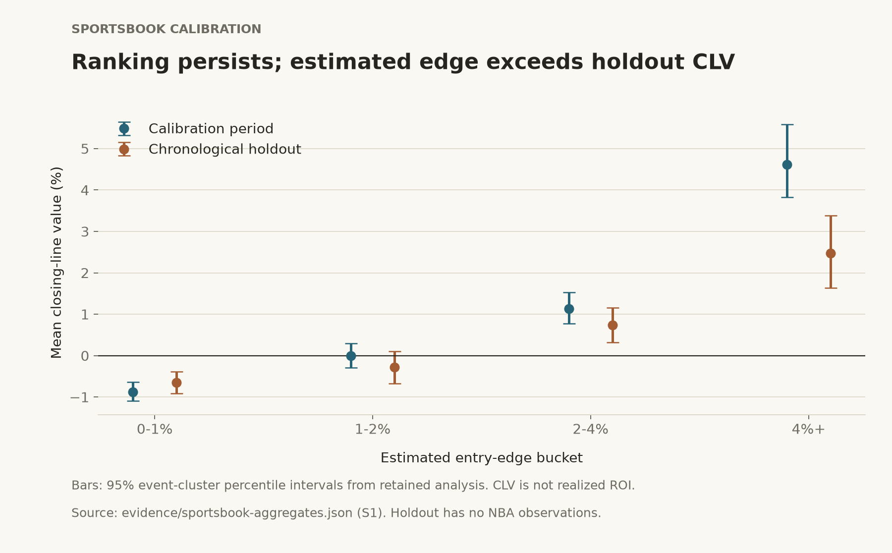

# Sportsbook calibration: estimated edge versus the closing reference

## Question

Does estimated entry edge rank captured opportunities by subsequent closing-line value, and how much of that estimated edge remains in a later chronological sample?

## Dataset

The retained export contains **7,722 rows and 7,722 unique captured opportunities**. Of those, **5,248** have usable closing observations across **873 event/game clusters**. **2,471** lack closing observations and **3** fail the study's **20-minute** close-validity window. The exclusions reconcile exactly to the captured total.

**Source:** [Sportsbook aggregate evidence](../evidence/sportsbook-aggregates.json), retained analysis S1. **Meaning:** captured unique opportunities and closing-reference eligibility, not placed or profitable bets. **Caveat:** missing closes can introduce selection bias; raw rows remain private. The public excerpt includes the private export's SHA-256 to bind its provenance.

## Experimental Design

Each opportunity contributes its immutable first-observed entry fields. Later sightings and hindsight-best prices do not replace the entry observation.

The earliest **80% of event clusters** form the calibration period and the latest **20%** the chronological holdout: **698 calibration clusters** and **175 holdout clusters**. Each event's ordering uses the scheduled start on its earliest retained first-seen row, with deterministic tie breaking. The holdout boundary is **2026-06-18 00:06 UTC**. Rescheduling does not split one event across periods; the retained report identifies **18 schedule-changed clusters affecting 285 observations**.

Chronological evaluation prevents later event clusters from informing a calibration-period choice. Freezing first observations also removes the particular leakage that would arise from choosing a better price seen later. These controls do not prove every upstream input was free of leakage.

Uncertainty uses **5,000 event-cluster percentile bootstrap resamples**, with a retained deterministic seed. All observations within a sampled event travel together. Treating correlated book/prop rows as independent would overstate sample information. Event clustering addresses within-event dependence; it does not eliminate possible dependence between events.

The entry-edge buckets were fixed for the analysis. They are reporting strata, not public trading rules. Feature generation and candidate-selection methods are withheld.

**Source:** [S1 methodology and split](../evidence/sportsbook-aggregates.json). **Caveat:** this portfolio reuses the retained aggregate output; it does not reconstruct the private export or rerun the bootstrap.

## Results

The pooled holdout preserves an ordering in mean CLV, while CLV is materially below mean estimated edge:

| Entry-edge bucket | Closing observations | Event clusters | Mean entry edge | Mean CLV | 95% event-cluster CI for mean CLV |
|---|---:|---:|---:|---:|---:|
| 0–1% | 331 | 148 | 0.44% | −0.65% | −0.91% to −0.38% |
| 1–2% | 161 | 99 | 1.45% | −0.28% | −0.68% to +0.10% |
| 2–4% | 137 | 95 | 2.71% | +0.74% | +0.32% to +1.16% |
| 4%+ | 57 | 46 | 5.17% | +2.47% | +1.63% to +3.38% |

**Source:** [S1 pooled holdout and calibration aggregates](../evidence/sportsbook-aggregates.json). **Meaning:** CLV evaluates the captured entry price against the closing reference; table values are rounded from retained aggregates. **Caveat:** event counts overlap between buckets and must not be summed as unique events. The intervals are bucket-wise, not simultaneous bounds or a formal test of monotonicity.

The lowest bucket's interval lies below zero. The next bucket's interval includes zero. The higher buckets have positive mean CLV in this historical holdout. Those observations support a descriptive ranking relationship, not the claim that estimated edge is accurately calibrated in magnitude.

## Limitations

- A closing reference is a market-based benchmark, not ground-truth probability. Positive CLV does not establish realized ROI.
- Captured opportunities reflect private selection and a historical sample. Missing closing prices need not be random.
- The holdout is compositionally narrow: **677 MLB prop observations, 9 MLB moneyline observations, and zero NBA observations**. It does not validate later NBA behavior or robust MLB moneyline performance. [Source S1](../evidence/sportsbook-aggregates.json)
- Historical provider fair-price freshness was not retained; time to scheduled start is not a substitute.
- Pooled sportsbook evidence does not validate exchange execution quality, maker fills, or future profitability.
- Multiple event clusters may share broader date/team effects; event bootstrap intervals do not address every dependence structure.

## Takeaway

Preserve entry-time information, evaluate later events separately, and report uncertainty at the dependence unit. Ranking information can be useful even when estimated edge overstates the closing-reference result. This study authorizes no production rule change or live trading conclusion.
